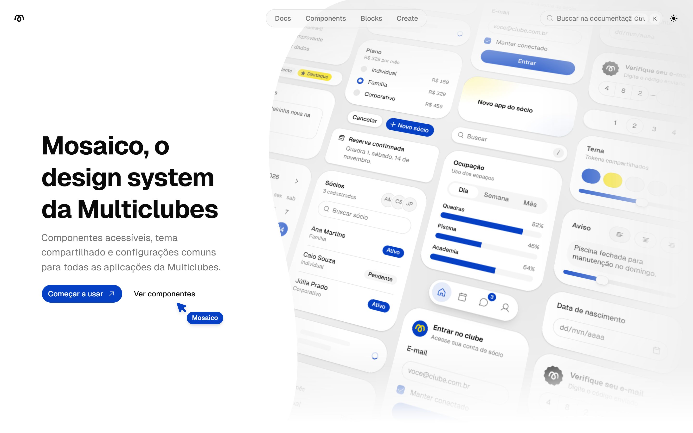
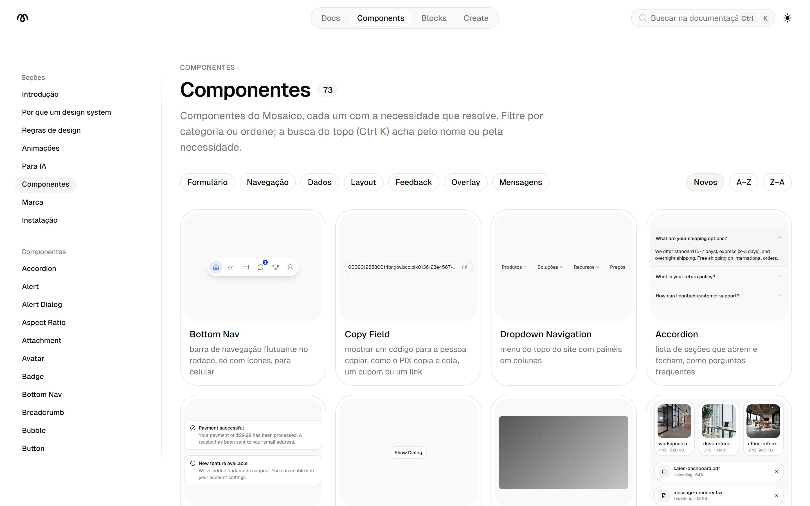
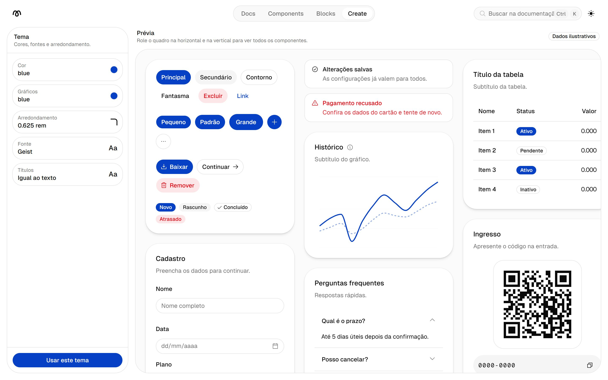
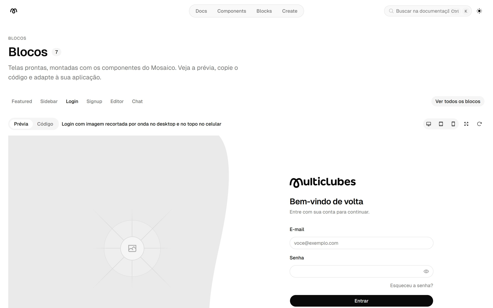
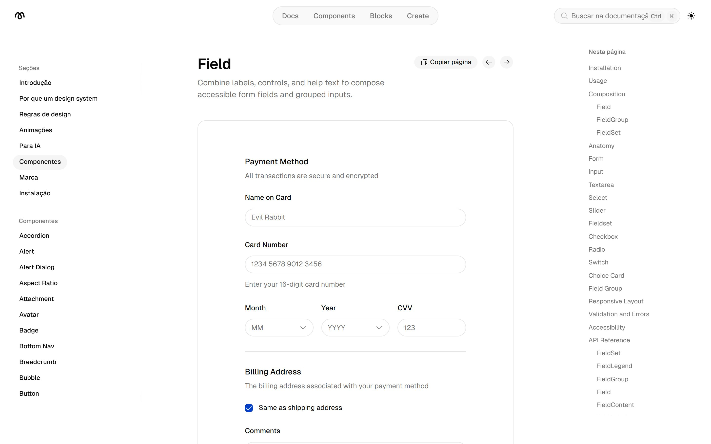
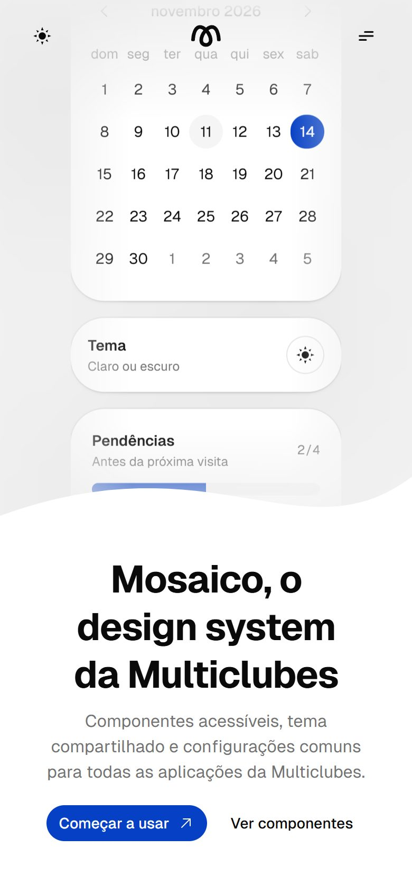
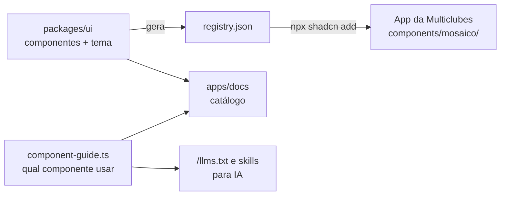

<div align="center">

# Mosaico

**O design system da Multiclubes.**
Componentes React acessíveis, um tema único com modo claro e escuro, e uma documentação viva para que todas as aplicações da empresa falem a mesma língua visual.

[**Ver o site →**](https://multiui-kit.vercel.app) &nbsp;·&nbsp; [Componentes](https://multiui-kit.vercel.app/docs/components) &nbsp;·&nbsp; [Criar um tema](https://multiui-kit.vercel.app/create) &nbsp;·&nbsp; [Blocos](https://multiui-kit.vercel.app/blocks)

[](https://github.com/CauaYves/mosaico/actions/workflows/ci.yml)


<br />

<picture>
  <source media="(prefers-color-scheme: dark)" srcset="docs/imagens/home-escuro.jpg" />
  
</picture>

</div>

## Para que serve

A Multiclubes mantém mais de uma aplicação web, como o **Portal** e o **WebCheckout**. Cada uma tinha a própria cópia de botões, campos, cartões, modais e tabelas. Uma correção feita em um produto não chegava ao outro, e o visual divergia aos poucos.

O Mosaico reúne essas peças num lugar só:

- **Componentes prontos e testados**, do botão ao diálogo de confirmação, com teclado, foco visível e leitor de tela funcionando.
- **Um tema compartilhado** com as cores da marca, raios e tipografia em variáveis CSS. Cada cliente pode trocar as variáveis sem tocar nos componentes.
- **Um catálogo navegável**, para designers, devs e produto verem cada componente, as variações e o código.
- **Regras de design escritas**, que valem para pessoas e para IAs que geram interface ou materiais da empresa.

## Destaques

| | |
| --- | --- |
| 🧩 **76 componentes** | Os do shadcn/ui (sobre Base UI) mais componentes próprios da marca, como `CopyField`, `DateField`, `BottomNav` e `Seal`. |
| ♿ **Acessibilidade testada** | 159 testes com Testing Library, e cada componente revisado passa pelo **axe** sem violações. |
| 🎨 **Tema por variáveis** | Modo claro e escuro, raios aninhados e cores de gráficos próprias, tudo em CSS variables. |
| 📦 **Distribuído pelo registry** | `npx shadcn add CauaYves/mosaico/<componente>` copia o código para o app, já com o tema. |
| 🧭 **Guia "qual componente usar"** | Cada componente diz que necessidade resolve. A CI falha se um componente novo entrar sem essa entrada. |
| 🤖 **Pronto para IA** | `/llms.txt`, páginas em Markdown e skills do Claude que ensinam as regras do kit. |

## Por dentro

### Catálogo de componentes

Cada componente tem uma prévia ao vivo, a necessidade que resolve em português e filtros por categoria.



### Crie o seu tema

Escolha a cor, a cor dos gráficos, o arredondamento e as fontes, e veja dezenas de componentes reagirem na hora. O botão **Usar este tema** gera o CSS para copiar.



### Blocos e páginas de componente

<table>
  <tr>
    <td width="50%"></td>
    <td width="50%"></td>
  </tr>
  <tr>
    <td><b>Blocos</b>: telas prontas (login, cadastro, sidebar, editor, chat) para copiar e adaptar.</td>
    <td><b>Páginas de componente</b>: exemplos, composição, acessibilidade e referência da API.</td>
  </tr>
</table>

### Feito para o celular



O catálogo e os componentes se adaptam à tela pequena. No celular, a vitrine fica no topo e termina numa onda, a navegação vira menu e os campos de data abrem uma roda de dia, mês e ano.

Todos os componentes usam só tokens semânticos (`bg-primary`, `text-muted-foreground`), então o modo escuro e os temas de cliente funcionam sem ajuste por tela.

<br clear="right" />

## Como funciona



1. **Os componentes vivem em `packages/ui`**, com o tema em `globals.css`.
2. **Um script gera o `registry.json`** a partir do código: dependências, imports internos e CSS de cada componente. A CI confere se ele está em dia.
3. **Cada app instala o que precisa** com o CLI do shadcn. O código vai para `components/mosaico/` e passa a ser do app, já com o tema da Multiclubes.
4. **O catálogo (`apps/docs`)** mostra tudo e publica as mesmas informações para IAs (`/llms.txt`, páginas em Markdown e skills).

```sh
# num app Next.js ou Vite
npx shadcn@latest init CauaYves/mosaico/base     # Phosphor, tema e regras do kit para o Claude
npx shadcn@latest add CauaYves/mosaico/button
```

## Stack

| Área | Ferramentas |
| --- | --- |
| Componentes | React 19, [Base UI](https://base-ui.com), [shadcn/ui](https://ui.shadcn.com) (estilo `base-luma`), ícones [Phosphor](https://phosphoricons.com) |
| Estilo | Tailwind CSS 4 com CSS variables, `tw-animate-css` |
| Catálogo | Next.js 16 (Turbopack), MDX, Shiki |
| Gráficos | Recharts |
| Qualidade | TypeScript 7, Vitest 5, Testing Library, axe-core, Biome |
| Monorepo | pnpm 12, Turborepo, GitHub Actions |

## Qualidade

Toda PR passa pela CI:

- **Lint e formatação** (Biome).
- **Tipos** (TypeScript) em todos os pacotes.
- **Testes** (Vitest + Testing Library), com o axe rodando sobre cada componente revisado.
- **Registry em dia**: o `registry.json` gerado bate com o código.
- **Guia de componentes completo**: todo componente e toda página têm uma entrada no guia, e toda entrada existe.
- **Referência das skills em dia**: as regras para IA saem da documentação e não podem ficar para trás.
- **Build** do catálogo e do playground.

O andamento da revisão de cada componente (direção visual, testes, acessibilidade e contraste) fica registrado na Fase 3 do [`docs/plano.md`](docs/plano.md).

## Estrutura do repositório

| Caminho | O que tem |
| --- | --- |
| `packages/ui` | `@multiclubes/ui`: componentes, hooks, tema (`globals.css`), testes e o gerador do registry |
| `apps/docs` | Catálogo: componentes, blocos, `/create`, regras de design e conteúdo para IA |
| `apps/web` | Playground que consome o kit como um app real |
| `packages/typescript-config` | `tsconfig`s compartilhados |
| `packages/biome-config` | Configuração base do Biome |
| `skills/` | Skill `mosaico-design`, com as regras para materiais da Multiclubes |
| `docs/plano.md` | Objetivo, arquitetura, decisões e plano de execução |

## Rodando localmente

Requisitos: Node.js 24 ou mais novo e pnpm 12.

```sh
pnpm install
pnpm dev            # sobe o catálogo (porta 3001) e o playground (porta 3000)
pnpm build          # build de todos os pacotes e apps
pnpm check-types    # verificação de tipos
pnpm test           # testes (Vitest)
pnpm lint           # Biome (lint + formatação)
pnpm lint:fix       # aplica as correções do Biome
```

Para rodar só um app: `pnpm exec turbo dev --filter=web`.

## Para quem mantém

<details>
<summary><b>Adicionar ou atualizar um componente</b></summary>

<br />

O `@multiclubes/ui` parte dos componentes do shadcn/ui no estilo `base-luma` (Base UI + Phosphor). Para adicionar ou atualizar um, rode o CLI dentro de `packages/ui`:

```sh
cd packages/ui
pnpm dlx shadcn@4.22.1 add dialog --overwrite
pnpm lint:fix   # na raiz: aplica a formatação do repositório
```

Os componentes importam `cn` do pacote [`cn`](https://github.com/shadcn-ui/cn), o utilitário oficial do shadcn, que substitui `clsx` + `tailwind-merge`. Apps também podem importá-lo de `@multiclubes/ui/lib/utils`.

Depois de adicionado, o componente é nosso: ajuste ao padrão do kit e escreva testes (`*.test.tsx` ao lado do componente, com `await expect(container).toHaveNoAxeViolations()`).

Os componentes próprios da Multiclubes ficam documentados em `apps/docs/content/docs/components-multiclubes` e `apps/docs/examples-multiclubes`, fora das pastas geradas pelo sync.

Todo componente novo precisa de uma entrada em `apps/docs/lib/component-guide.ts`, que diz qual necessidade ele resolve. Dela saem a galeria, o `/llms.txt` e a tabela das skills. `pnpm --filter docs guide:check` falha na CI se faltar.

</details>

<details>
<summary><b>Documentação gerada do shadcn</b></summary>

<br />

`apps/docs` reproduz a documentação do [ui.shadcn.com](https://ui.shadcn.com) para os componentes do kit. As páginas (`content/docs/components`) e os exemplos (`examples/`) são gerados a partir do repositório do shadcn/ui (MIT):

```sh
pnpm --filter docs sync:shadcn
```

O script baixa a documentação, troca os imports para `@multiclubes/ui`, substitui a seção de instalação e descarta exemplos que dependem de código interno do site do shadcn (o resumo lista quais e por quê). Ele também insere antes de "Installation" as notas do Mosaico mantidas à mão em `content/mosaico-notas/<componente>.mdx`. Não edite os arquivos gerados. As páginas próprias (`content/docs/index.mdx`, `installation.mdx` e as demais fora de `components/`) são mantidas à mão.

</details>

<details>
<summary><b>Registry</b></summary>

<br />

`packages/ui/registry.json` é gerado do código de `packages/ui/src` (imports, dependências e o tema de `globals.css`). Depois de mudar um componente, rode:

```sh
pnpm --filter @multiclubes/ui registry
```

A CI falha se o arquivo estiver desatualizado. Imports entre arquivos do kit usam o formato `@/registry/mosaico/{components,hooks,lib}/mosaico/<nome>`, que o CLI do shadcn reescreve para os aliases de quem instala. Os apps do monorepo continuam importando de `@multiclubes/ui/components/<nome>`.

`pnpm --filter @multiclubes/ui registry:smoke` instala itens da `main` num projeto novo e confere o resultado. Roda na CI depois de cada push na `main`.

Detalhes de instalação, temas de cliente e fonte estão na página [Instalação](https://multiui-kit.vercel.app/docs/installation) do catálogo.

</details>

<details>
<summary><b>Conteúdo para IA</b></summary>

<br />

A página `/docs/para-ia` traz os princípios do Mosaico escritos como instrução para uma IA (relatórios, documentação, templates de e-mail, protótipos). Ela também sai em Markdown puro em `/md/para-ia`, e o catálogo publica um índice em `/llms.txt`.

A skill `skills/mosaico-design` carrega essas instruções sozinha quando alguém pede material da Multiclubes. Para instalar, copie a pasta para `~/.claude/skills/` (Claude Code) ou envie-a como skill no Claude. Em apps que usam o kit, `npx shadcn@latest init CauaYves/mosaico/base` instala duas skills: `mosaico-ui`, com as regras de código, e `mosaico-prototipo`, com o ciclo para construir e lapidar uma tela (alvo, cenários, conferência por captura e revisão).

As referências das skills são geradas da página. Depois de mudar `apps/docs/content/docs/para-ia.mdx` ou o guia de componentes, rode `pnpm --filter docs sync:ia`.

</details>
