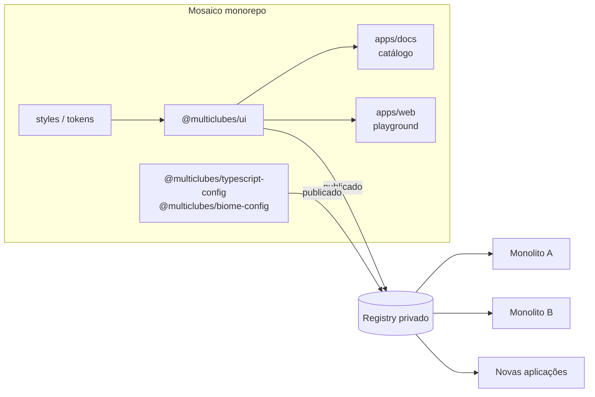

# Mosaico — Visão e plano

> Status: rascunho · Última atualização: 2026-10-21

## 1. Contexto

A Multiclubes mantém hoje **dois projetos em Next.js estruturados como monolitos**. O principal é o **Portal** (`Applications/Portal` no repositório `MultiClubes/Code` do Azure DevOps). Cada um tem sua própria cópia de componentes de interface (botões, inputs, cards, modais, tabelas…) e de configurações (TypeScript, lint/format, Tailwind/tema, fontes).

Isso gera alguns problemas:

- **Retrabalho:** a mesma correção ou melhoria precisa ser feita duas vezes.
- **Divergência visual:** os componentes "iguais" evoluem de forma diferente em cada projeto, e o usuário percebe produtos que não parecem da mesma empresa.
- **Custo de começar algo novo:** cada nova aplicação parte do zero ou copia código de um dos monolitos, herdando a divergência.

## 2. Objetivo

Criar o **Mosaico**, o design system da Multiclubes: um monorepo que concentra o que é compartilhável entre as aplicações da Multiclubes e o publica como pacotes versionados.

Objetivos concretos:

1. **Um padrão visual único e novo**, definido por design tokens (cores, tipografia, espaçamento, raios, sombras) e aplicado por um tema.
2. **Uma biblioteca de componentes React criada do zero**: acessível, tipada, documentada e consumida pelos dois monolitos.
3. **Configurações compartilhadas** (TypeScript, Biome, Tailwind/PostCSS) para que os projetos tenham o mesmo padrão de código.
4. **Publicação em um registry** para que aplicações futuras, em qualquer repositório, instalem os pacotes com `pnpm add`.
5. **Documentação viva** com exemplos de uso de cada componente.

### Fora do escopo (por enquanto)

- **Copiar ou extrair componentes dos monolitos.** Os componentes são escritos do zero neste repositório, com o estilo próprio do kit. Os monolitos servem apenas como referência de *quais* componentes são necessários e de quais restrições técnicas precisam ser respeitadas (ver [seção 3.1](#31-restrições-vindas-do-portal)).
- Juntar os apps num workspace (monorepo JavaScript). Esse é o objetivo **futuro**, descrito na [seção 10](#10-objetivo-futuro-workspace-dos-apps-frontend); agora o foco é terminar o kit.
- Compartilhar regras de negócio, chamadas de API ou estado global. O kit é só de **UI e configuração**.
- Reescrever telas inteiras. A adoção é incremental, componente por componente.

## 3. Estado atual do repositório

O repositório foi criado a partir do starter do Turborepo e começou a ser configurado para shadcn/ui, mas ainda não funciona como biblioteca:

> Diagnóstico feito antes da Fase 1. Todos os itens abaixo foram resolvidos nela.

| Item | Situação |
| --- | --- |
| Monorepo | Turborepo + pnpm workspaces (`apps/*`, `packages/*`) ✅ |
| Nome/escopo | Raiz chamada `my-turborepo`; pacotes no escopo `@repo/*`; `apps/web/components.json` usa `@workspace/ui` (inconsistente) |
| `packages/ui` | `exports` aponta para `./src/*.tsx`, mas os arquivos estão em `shadcn/`; o CSS referenciado (`src/styles/globals.css`) não existe |
| Componentes | Apenas os stubs do starter (`Button` com `alert`, `Card` com links de UTM, `Code`) |
| Tailwind | Referenciado no `components.json`, mas não instalado |
| Lint/format | Biome na raiz, mas `apps/docs` importa `@repo/eslint-config` (inexistente) e o script `format` chama Prettier (não instalado) |
| Build/publicação | Não há build da biblioteca, versionamento, changelog nem CI |
| Testes | Nenhum |
| README | Ainda é o do starter |

### 3.1 Restrições vindas do Portal

O kit não reaproveita código do Portal, mas precisa encaixar nele. A stack atual do Portal define estas restrições:

| No Portal | Impacto no kit |
| --- | --- |
| Next 16.3, React 19.2 | `peerDependencies`: `react`/`react-dom` `^19.2` e testes do kit contra essas versões |
| Tailwind v4 via `@tailwindcss/postcss` | Confirma Tailwind v4 como estratégia de estilo; o consumo via `@import` + `@source` funciona sem mudar o setup do Portal |
| **Temas por cliente** (`src/themes/flamengo`, `vitrine`, `vitrine-v2`) que sobrescrevem CSS variables no padrão shadcn (`--primary`, `--background`, `--radius`, `--sidebar`…) | O kit precisa suportar **multi-tema (white-label)**: um tema padrão Multiclubes + temas de cliente que só sobrescrevem variáveis. Manter os **nomes de variáveis do contrato shadcn** faz os temas de cliente continuarem funcionando com os novos componentes |
| `next-themes` + `global-dark-mode.css` | Modo escuro por classe (`.dark`), compatível com `next-themes` |
| shadcn `new-york` com Radix e ícones `lucide-react` | O kit usa Base UI e Phosphor. Na migração, as duas bases convivem no Portal até o componente antigo ser removido. É aceitável, mas aumenta o bundle temporariamente |
| npm (`package-lock.json`), não pnpm | O pacote publicado não pode depender de nada específico do pnpm (`workspace:*` é resolvido na publicação) |
| Biome 1.9 | A `@multiclubes/biome-config` usa Biome 2.x, que tem formato de configuração diferente. Adotá-la no Portal exige atualizar o Biome lá |
| Vitest | Mesmo runner de testes no kit, para facilitar contribuições |
| Repositório no Azure DevOps | Azure Artifacts é o registry natural (mesma autenticação e pipelines) |

## 4. Arquitetura proposta

### 4.1 Pacotes

| Pacote | Conteúdo | Publicado? |
| --- | --- | --- |
| `@multiclubes/ui` | Componentes React, utilitário `cn`, hooks de UI e o CSS do tema (`@multiclubes/ui/styles.css`) com os tokens em CSS variables | Sim |
| `@multiclubes/typescript-config` | `base.json`, `nextjs.json`, `react-library.json` | Sim |
| `@multiclubes/biome-config` | Configuração base do Biome, usada via `extends` | Sim |
| `apps/docs` | Catálogo/documentação dos componentes | Não (deploy como site interno) |
| `apps/web` | Playground que consome o kit **como um app real consumiria** | Não |

Os tokens começam dentro de `@multiclubes/ui`. Se surgir uma demanda real de consumir tokens sem os componentes (e-mail, app mobile, ferramentas de design), eles viram um pacote `@multiclubes/tokens` separado.

### 4.2 Base técnica dos componentes

- **shadcn/ui** como ponto de partida (o repositório já está configurado com o estilo `base-luma`, primitivos Base UI e ícones Phosphor). Os componentes gerados passam a ser **nossos**: ajustados ao padrão Multiclubes e mantidos aqui.
- **Tailwind CSS v4** com tema definido por CSS variables, suportando modo claro/escuro.
- **Multi-tema:** o kit publica o tema padrão Multiclubes; cada app ou cliente pode sobrescrever as variáveis (cores, raio, fontes) sem tocar nos componentes. Os componentes só usam tokens semânticos (`bg-primary`, `text-muted-foreground`), nunca cores fixas.
- **Sem dependência de Next.js** dentro de `@multiclubes/ui`. Integrações como `Link` e `Image` entram por composição (`render`/`asChild`), para que apps que não usam Next também consumam o kit.
- `react` e `react-dom` como `peerDependencies`.

### 4.3 Como os componentes são distribuídos

> **Decidido em 2026-11-09:** registry shadcn (modelo B). Desenho: [specs/2026-11-09-registry-shadcn-design.md](superpowers/specs/2026-11-09-registry-shadcn-design.md).

Os monolitos estão em outros repositórios, então o workspace (`workspace:*`) só atende os apps internos do kit. Para fora, havia dois modelos:

| Modelo | Como funciona | Prós | Contras |
| --- | --- | --- | --- |
| A. Pacote npm compilado (descartado) | `@multiclubes/ui` é buildado (ESM + `.d.ts`) e publicado; apps instalam e atualizam por versão | Uma fonte da verdade; correções chegam via upgrade | Customização local exige props/variantes previstas no kit; exige build, registry npm privado e release |
| **B. Registry shadcn** (adotado) | O kit expõe um `registry.json`; apps rodam `npx shadcn@latest add CauaYves/mosaico/<nome>` e recebem o código-fonte | Liberdade para editar no app; sem build nem servidor | Cada app vira dono da cópia: a divergência pode voltar |

**Por que o modelo B:** a equipe quer que cada projeto receba o código e possa ajustá-lo, como no shadcn. A divergência é mitigada por: tema único reaplicado a cada `add`, `add` de novo para atualizar e o catálogo como referência.

Como funciona:

- O registry é servido direto do GitHub (`CauaYves/mosaico`, repositório público): o CLI lê o `registry.json` da raiz e copia os arquivos de `packages/ui/src`. Sem build, sem servidor, sem domínio.
- Sem versão nos comandos: todo `add` traz o que está na `main`, que precisa estar sempre estável.
- Os arquivos vão para `components/mosaico/`, `hooks/mosaico/` e `lib/mosaico/` e convivem com o shadcn oficial em `components/ui` durante uma migração.
- Todo componente depende do item `theme`, que aplica as cores Multiclubes no CSS global. Temas de cliente ficam num arquivo separado, carregado depois.
- `packages/ui/registry.json` é gerado do código e checado na CI.

### 4.4 Versionamento e release

- A `main` é a versão publicada: um merge na `main` chega a quem rodar `add` depois.
- Mudanças que quebram compatibilidade são avisadas no changelog e passam por `@deprecated` antes de sair (ver [Governança](#6-governança)).

## 5. Plano de execução

### Fase 0 — Direção visual e requisitos

Definir o que será construído e com que cara. Nada é copiado dos monolitos.

- Definir a direção visual do kit: paleta, tipografia, raios, densidade, tom dos estados (hover, foco, erro), modo escuro.
- Listar os componentes que o Portal e o WebCheckout usam, para saber **quais** construir e em que ordem (só a lista, não o código).
- Mapear o contrato de variáveis que os temas de cliente do Portal sobrescrevem, para que o kit o respeite.
- Levantar a stack do WebCheckout (a do Portal está na [seção 3.1](#31-restrições-vindas-do-portal)).
- Responder as [decisões em aberto](#8-decisões-em-aberto).

**Pronto quando:** a direção visual está definida, a lista de componentes está priorizada e as decisões de registry e escopo estão tomadas.

### Fase 1 — Fundação do repositório ✅

Corrigir o starter e deixar a base pronta para receber componentes.

> **Concluída em 2026-10-21.** Pacotes renomeados para `@multiclubes/*`; `packages/ui` reorganizado em `src/` com `exports` por subpath; Tailwind v4 no kit e nos apps; Biome como única ferramenta de lint/format, com `@multiclubes/biome-config`; Vitest + Testing Library no `ui`; `Button` (shadcn `base-luma`) com testes, renderizado no `web` e no `docs`; CI em GitHub Actions (lint, tipos, testes, build).
- Renomear raiz e pacotes para o escopo `@multiclubes/*` e alinhar todos os `components.json`.
- Reorganizar `packages/ui` (`src/components`, `src/lib`, `src/hooks`, `src/styles`) e ajustar `exports` e `tsconfig`.
- Instalar e configurar Tailwind v4 no `ui` e nos apps internos.
- Padronizar em Biome (remover referências a ESLint/Prettier) e criar `@multiclubes/biome-config`.
- CI no PR: `check-types`, `format-and-lint`, `build`, testes.
- Substituir o README do starter.

**Pronto quando:** `pnpm build` e `pnpm check-types` passam, `apps/web` renderiza um componente do `ui` com o tema aplicado, e a CI roda em todo PR.

### Fase 2 — Tokens e tema

- Traduzir a direção visual definida na Fase 0 em tokens (CSS variables) e no tema do Tailwind.
- Tipografia e fontes oficiais, escala de espaçamento, raios, sombras, breakpoints.
- Modo claro e escuro.
- Mecanismo de temas de cliente: um tema de exemplo que só sobrescreve variáveis, provando que o white-label funciona.
- Página de tokens no catálogo, com troca de tema e de modo claro/escuro.

**Pronto quando:** o tema padrão reproduz a direção visual, um tema de cliente funciona sem alterar componentes, e ambos estão documentados.

### Fase 3 — Componentes base (em andamento)

> **2026-10-21:** todos os 63 componentes do shadcn/ui (`base-luma`) foram adicionados ao `@multiclubes/ui`, além de dois componentes próprios trazidos do Portal (`DateWheelPicker` e `DateField`, com testes), e o `apps/docs` reproduz a documentação do ui.shadcn.com para eles: 66 páginas e 420 exemplos, gerados por `apps/docs/scripts/sync-shadcn.mjs`. Ainda faltam, por componente: aplicar a direção visual da Fase 2, testes (só o `Button` tem) e verificação de a11y. O conteúdo das páginas de componente está em inglês, como no original.

Começar pelos componentes que o Portal mais usa, segundo a lista da Fase 0. Primeira leva sugerida:

`Button`, `Input`, `Textarea`, `Select`, `Checkbox`, `Radio`, `Switch`, `Label`/`Field`, `Card`, `Dialog`, `Dropdown Menu`, `Tooltip`, `Toast`, `Tabs`, `Table`, `Badge`, `Avatar`, `Skeleton`, `Spinner`.

Para cada componente:

- API tipada e consistente (variantes, tamanhos, `className`, composição).
- Acessibilidade: teclado, foco visível, ARIA, contraste.
- Testes com Vitest + Testing Library, incluindo verificação automática de a11y (axe).
- Página no catálogo com exemplos e props.

**Pronto quando:** a primeira leva está publicada em `0.x`, documentada e testada.

### Fase 4 — Publicação

> **2026-11-09:** distribuição pelo registry shadcn (ver [4.3](#43-como-os-componentes-são-distribuídos)). Sai do plano o pacote npm: build ESM, Azure Artifacts e Changesets.

- Registry servido pelo GitHub, gerado do código e checado na CI; teste de instalação ponta a ponta depois de cada push na `main`.
- Deploy do catálogo como site interno.

**Pronto quando:** um projeto fora do monorepo roda `npx shadcn@latest add CauaYves/mosaico/<nome>` e usa o componente sem nenhum ajuste manual.

### Fase 5 — Piloto no Portal

- Instalar o kit e o tema, convivendo com os componentes atuais em `src/components/ui`.
- Validar os temas de cliente (`flamengo`, `vitrine`, `vitrine-v2`) com os componentes do kit.
- Substituir componentes de forma incremental (começando por telas de menor risco), removendo o componente antigo e suas dependências (Radix, lucide) à medida que cada um é migrado.
- Atualizar o Biome para 2.x e adotar `@multiclubes/typescript-config` e `@multiclubes/biome-config`.
- Registrar atritos de API e devolvê-los ao kit como melhorias.

**Pronto quando:** os componentes base do Portal vêm do kit, os temas de cliente funcionam e não há regressões relevantes.

### Fase 6 — Adoção no WebCheckout

- Repetir o processo da Fase 5, já com a API amadurecida pelo piloto.
- Publicar `1.0.0`.

**Pronto quando:** os dois monolitos usam a mesma versão major do kit para os componentes base.

### Fase 7 — Evolução contínua

- Componentes compostos e padrões recorrentes (formulários, tabelas com filtro/paginação, layouts).
- Testes de regressão visual (ex.: screenshots com Playwright) no catálogo.
- Avaliar blocos/templates no registry (segunda etapa do registry).
- Template de nova aplicação já configurada com o kit.

## 6. Governança

- **Donos:** definir um time/pessoas responsáveis por revisar PRs no kit.
- **Contribuição:** qualquer dev pode propor componente ou mudança via PR, com changeset, testes e documentação.
- **Critério de entrada:** um componente entra no kit quando é usado (ou vai ser usado) por pelo menos dois projetos. Componentes específicos de um produto continuam no produto.
- **Breaking changes:** só em versão major, com guia de migração no changelog. Antes de remover, marcar como `@deprecated` por pelo menos uma versão minor.
- **Design:** mudanças visuais passam pelo responsável de design.

## 7. Riscos e mitigações

| Risco | Mitigação |
| --- | --- |
| Segundo monolito com stack de estilo diferente (ex.: sem Tailwind) dificulta a adoção | Mapear na Fase 0; se necessário, publicar também CSS compilado |
| Novo visual quebra os temas de cliente do Portal | Manter o contrato de variáveis shadcn; validar cada tema de cliente no piloto |
| Visual novo muda a experiência dos usuários atuais do Portal | Alinhar com produto antes do piloto; migrar por tela, não tudo de uma vez |
| Radix + Base UI e lucide + Phosphor convivendo no Portal durante a migração | Remover a dependência antiga assim que o último componente que a usa for migrado |
| Versões de React/Next diferentes entre os projetos | `peerDependencies` com faixa compatível; testar o kit contra as versões em uso |
| Kit vira gargalo (apps esperando componentes) | Critério de entrada claro; apps podem estender localmente via composição enquanto o kit evolui |
| Regressões visuais na migração | Migração incremental por tela; regressão visual no catálogo; validação com QA/design |
| Divergência volta com o tempo | Governança, catálogo como referência e lint/configs compartilhados |
| Dependência pesada de uma única pessoa | Documentação, revisão em par e mais de um dono do kit |

## 8. Decisões em aberto

| # | Decisão | Opções | Recomendação |
| --- | --- | --- | --- |
| 2 | Escopo dos pacotes | `@multiclubes/*`, outro | `@multiclubes/*` |
| 4 | Ferramenta do catálogo | `apps/docs` (Next + MDX), Storybook | Definir após a Fase 0 conforme a necessidade de testes visuais |
| 5 | Onde o repositório do kit vai morar | GitHub (atual, `CauaYves/mosaico`), Azure DevOps da Multiclubes | GitHub: o registry shadcn de repositório só funciona com github.com (2026-11-09) |
| 6 | Donos do kit | — | — |

**Decidido:**

- **Padrão visual:** identidade nova, criada neste repositório. Os componentes são escritos do zero, sem copiar código dos monolitos.
- **App piloto:** Portal.
- **Distribuição (2026-11-09):** registry shadcn servido pelo GitHub, sem pacote npm (ver [4.3](#43-como-os-componentes-são-distribuídos)). Substitui a decisão em aberto sobre o registry de publicação.
- **Estratégia de estilo:** Tailwind v4 + CSS variables, com o tema aplicado pelo registry.

## 9. Como medir o sucesso

- Número de componentes duplicados removidos dos monolitos.
- Percentual de telas usando componentes do kit.
- Tempo para iniciar uma nova aplicação com o padrão visual completo.
- Tempo entre uma correção no kit e sua chegada nos dois projetos.

## 10. Objetivo futuro: workspace dos apps frontend

> Registrado em 2026-10-22. **Não é o foco agora:** primeiro o kit fica pronto (fases 2 a 4) e é adotado pelo Portal. Esta seção guarda a direção para depois.

### Situação atual

Os apps frontend da Multiclubes já estão no mesmo repositório, o `MultiClubes/Code` (Azure DevOps), majoritariamente .NET, em `Applications/`. Cada app tem o próprio `package-lock.json`, sem workspace JavaScript ligando os apps:

| App | Next | React | UI | Variáveis de ambiente usadas |
| --- | --- | --- | --- | --- |
| Portal | 16.3 | 19.2 | shadcn (Radix) + Tailwind v4 | `KERNEL_URL`, `AUTH_KEY`, `COOKIE_SECRET`, `NEXT_PUBLIC_CUSTOMER`, `NEXT_PUBLIC_THEME`, `SEO_*` |
| WebCheckout | 15.5 | 19.2 | shadcn (Radix) + Tailwind v4 | `API_URL`, `COOKIE_SECRET`, `NEXT_PUBLIC_CUSTOMER`, `NEXT_PUBLIC_THEME`, `NEXT_PUBLIC_MULTICLUBES_HUB_URL` |
| Dashboard | 15.5 | 19.1 | MUI 7 + Emotion | `KERNEL_URL`, `AUTH_KEY`, `SESSION_SECRET`, `NEXT_PUBLIC_CUSTOMER`, `DASHBOARD_*`, `APP_*` |
| PhotoCapture | — | 19 | — | — |

Os três apps Next já usam Turbopack e `output: "standalone"`.

### Objetivo

Um workspace **pnpm + Turborepo na raiz do `Code`**, cobrindo os apps JavaScript de `Applications/` e uma pasta de pacotes compartilhados (kit de UI e configurações). Os apps **não** saem do `Code`.

**Ganhos esperados**

- Mudança no kit e nos apps no mesmo PR, com `check-types` acusando o que quebrou.
- Versões de React, Next, Tailwind e TypeScript declaradas uma vez (catálogo do pnpm).
- CI seletiva (`turbo run build --affected`) e cache de tarefas, inclusive remoto.
- Instalação mais rápida e menos disco: o pnpm guarda cada versão de pacote uma vez só.

**O que não muda:** consumo de RAM. Cada `next dev` continua sendo um processo próprio; o ganho é em disco, instalação e CI.

### Configuração compartilhada (`.env`)

- Um arquivo comum, por ambiente, com o que é de fato compartilhado: `KERNEL_URL`, `AUTH_KEY` (se for a mesma credencial), `NEXT_PUBLIC_CUSTOMER`, `NEXT_PUBLIC_THEME`. Cada app carrega o arquivo comum no `next.config` (`loadEnvConfig`), e o `.env` do próprio app tem precedência.
- **Segredos de cookie e sessão continuam por app** (`COOKIE_SECRET`, `SESSION_SECRET`): compartilhá-los faria um cookie de um app valer no outro.
- Em produção, o equivalente é um *Variable Group* do Azure DevOps ligado às pipelines dos apps.
- Pendente: confirmar se o `API_URL` do WebCheckout é o mesmo serviço do `KERNEL_URL`.

### Etapas

1. **Pré-requisitos (podem começar já):** WebCheckout e Dashboard no Next 16 e React 19.2, e TypeScript alinhado. No WebCheckout, `middleware.ts` vira `proxy.ts` e as APIs de request (`cookies()`, `headers()`, `params`) passam a ser assíncronas.
2. **Kit pronto e publicado** (fases 2 a 4) e adotado pelo Portal (fase 5).
3. **Workspace no `Code`** com Portal e WebCheckout: migração de npm para pnpm (corrigir imports de pacotes não declarados), `turbo.json` com as variáveis de ambiente declaradas para o cache, pipelines fazendo o build a partir da raiz (`turbo prune` para Docker, `outputFileTracingRoot` no `standalone`).
4. **Dashboard e PhotoCapture** entram depois. No Dashboard, a troca de MUI pelo kit é um projeto à parte (conflito entre o reset do Tailwind e o `CssBaseline` do MUI).

### Riscos

| Risco | Mitigação |
| --- | --- |
| Migrar tudo de uma vez e quebrar os builds | Um app por vez, começando pelo Portal |
| Kit ainda instável afetando todos os apps no mesmo commit | Só montar o workspace depois que a API e o visual do kit assentarem |
| Ninguém responsável pela infraestrutura JavaScript num repositório .NET | Definir os donos antes da etapa 3 |
| Cache do Turborepo reaproveitando build com outro `.env` | Declarar as variáveis em `env` / `globalEnv` no `turbo.json` |

### Consumo de memória (independente do workspace)

Medidas para avaliar com medição antes e depois:

- **Desenvolvimento:** abrir no editor só a pasta do app (não o `Code` inteiro); subir só o app em uso; `experimental.optimizePackageImports: ["@phosphor-icons/react"]` (o Next não otimiza o Phosphor por padrão, e ele é a biblioteca de ícones do kit e do Dashboard); TypeScript 7 nativo no editor.
- **Produção:** `experimental.preloadEntriesOnStart: false` (padrão `true` no Next 16.3), `cacheMaxMemorySize` e `experimental.imgOptConcurrency`. No Portal, que roda uma instância por cliente, a economia se multiplica.
